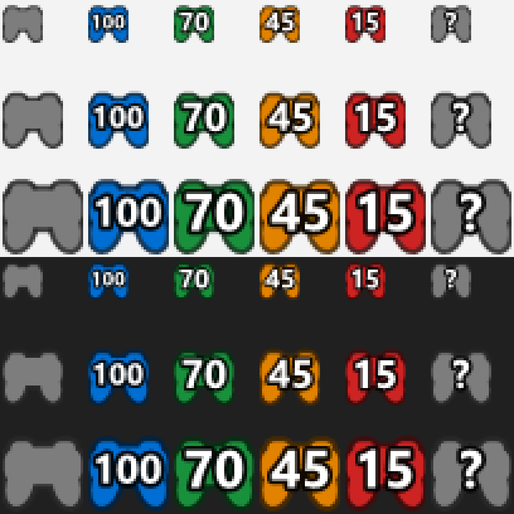

# DualSense Battery

Petite application Windows qui détecte une manette PS5 (DualSense ou DualSense Edge)
connectée en USB ou en Bluetooth et affiche son niveau de batterie dans la zone de
notification.



## Fonctionnalités

- Icône en forme de manette avec le pourcentage, colorée selon le niveau :
  vert (> 50 %), orange (21 à 50 %), rouge (≤ 20 %), bleu en charge, gris sans manette.
- Jusqu'à 4 manettes à la fois : une icône par manette, numérotée de 1 à 4 dans
  l'ordre de connexion. Le numéro est aussi envoyé aux voyants joueur de la manette,
  comme sur PS5.
- Infobulle et clic gauche : numéro, modèle, type de connexion et état de charge.
- Notification à la connexion de la manette et quand la batterie passe sous 20 %.
- Barre lumineuse de la manette (de chaque côté du pavé tactile) à la couleur de la
  batterie, réglée à la connexion puis à chaque changement de tranche.
- Option « Lancer au démarrage de Windows » dans le menu du clic droit.
- Aucune dépendance : un seul `.exe` compilé avec le compilateur C# fourni avec Windows.

## Compilation

Windows 10/11 avec .NET Framework 4.x (présent par défaut). Lancer :

```bat
build.bat
```

qui produit `DualSenseBattery.exe` à côté des sources. Il suffit ensuite de le lancer.

## Diagnostic

```bat
DualSenseBattery.exe --dump
```

affiche l'état lu sur la manette (pourcentage, octet brut de batterie, horloge interne
de la manette pour vérifier que les données sont fraîches). Ajouter `--light` envoie
aussi la couleur de batterie à la barre lumineuse.

## Limites connues

- La manette ne donne son niveau que par paliers de 10 % : « 70 % » signifie 70 à 79 %.
- En Bluetooth, la manette n'envoie la batterie qu'en mode de rapport étendu (0x31).
  L'application l'y fait passer en lisant le rapport de calibration 0x05, comme Steam et
  les jeux compatibles DualSense. Un vieux jeu lisant la manette en DirectInput sans
  Steam peut alors ne plus voir les commandes jusqu'à la reconnexion de la manette.
- Une manette masquée par HidHide (DS4Windows) n'est pas visible par l'application.
- Le clignotement des voyants joueur sous le pavé tactile, lorsqu'il se produit sur PC,
  est piloté par la manette elle-même et ignore les commandes de voyants.

## Détails techniques

Lecture HID directe (`hid.dll` / `setupapi.dll`), VID `054C`, PID `0CE6` (DualSense)
et `0DF2` (DualSense Edge). L'octet d'état de batterie est à l'offset 53 du rapport
USB `0x01` et à l'offset 54 du rapport Bluetooth `0x31` : quartet bas = niveau 0..10,
quartet haut = état (0 sur batterie, 1 en charge, 2 chargée). Les commandes de
lumière utilisent le rapport de sortie `0x02` (USB) ou `0x31` (Bluetooth, avec CRC32).
